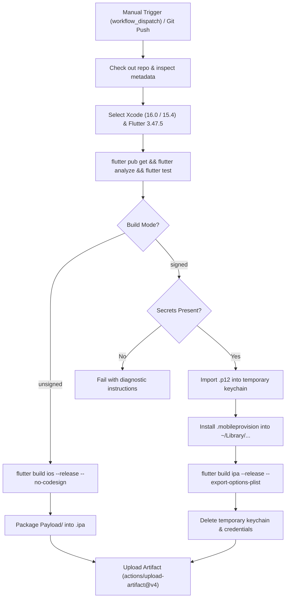

# LedgerLeaf iOS IPA Build & Distribution Guide

**Target Environment:** Apple iOS (iOS 16.0+ minimum, iOS 17.0+ recommended)  
**CI/CD Engine:** GitHub Actions (`macos-14` Apple Silicon runner)  
**Workflow File:** [`.github/workflows/ios-ipa.yml`](file:///home/michael/projects/app/money_manager/.github/workflows/ios-ipa.yml)  
**Application Bundle ID:** `com.ledgerleaf.ledgerleaf` (configurable via `IOS_BUNDLE_ID`)  
**App Group:** `group.com.ledgerleaf.app` (configurable via `IOS_APP_GROUP`)

---

## 1. Overview & Build Modes

LedgerLeaf's CI/CD workflow builds an iOS `.ipa` package directly on GitHub-hosted macOS runners. The workflow supports two distinct operational modes:

| Feature / Property | Mode A: Unsigned Build (`unsigned`) | Mode B: Signed Build (`signed`) |
|---|---|---|
| **Primary Purpose** | CI verification, binary inspection, local re-signing | Production & ad-hoc distribution to real iPhones |
| **Signing Credentials** | None required | Requires Apple Developer Certificate (`.p12`) & Profile |
| **GitHub Secrets Required** | None (runs out-of-the-box on every PR/push) | `IOS_CERTIFICATE_BASE64`, `IOS_CERTIFICATE_PASSWORD`, `IOS_PROVISIONING_PROFILE_BASE64`, `IOS_TEAM_ID` |
| **Direct iPhone Installation** | ❌ Cannot be installed on stock iOS without a tool | ✅ Direct installation on registered devices |
| **Sideloading Compatibility** | AltStore, Sideloadly (re-signs on PC), TrollStore | Apple Configurator, Xcode, AltStore, Sideloadly |

> [!WARNING]
> **Understanding Unsigned IPAs:**  
> An unsigned IPA contains the fully compiled binary (`Runner.app`) and all Flutter assets, but lacks Apple's cryptographic code signature. **iOS will reject an unsigned IPA if you attempt to install it directly.** It must either be signed during CI (Mode B) or re-signed with your personal Apple ID using a desktop sideloading utility (Mode A).

---

## 2. Pushing the Workflow to GitHub

Ensure your local changes and workflow are committed and pushed to your GitHub repository:

```bash
# 1. Inspect repository status
git status

# 2. Push to your GitHub remote
git push origin main
```

Once pushed, GitHub Actions automatically detects `.github/workflows/ios-ipa.yml`.

---

## 3. Running the Workflow from GitHub Actions

You can trigger builds manually at any time:

1. Navigate to your repository on GitHub.
2. Click on the **Actions** tab at the top.
3. In the left sidebar, select **Build LedgerLeaf iOS IPA**.
4. Click the **Run workflow** dropdown on the right:
   - **Branch:** Select `main` (or your feature branch).
   - **Build distribution type:**
     - Select `unsigned` (default) for inspection or local re-signing.
     - Select `signed` for a device-ready IPA (requires configured secrets).
   - **Export method:** `development` (recommended for personal sideloading) or `ad-hoc`.
   - **Flutter SDK version:** `3.47.5` (or leave default).
5. Click **Run workflow**.



---

## 4. Downloading the Generated IPA Artifact

1. In the **Actions** tab, click on the completed workflow run.
2. Scroll down to the **Artifacts** section at the bottom of the summary page.
3. Click on the artifact link:
   - Unsigned artifact: `ledgerleaf-ios-unsigned-<commit-sha>`
   - Signed artifact: `ledgerleaf-ios-signed-<commit-sha>`
4. Extract the downloaded `.zip` file to obtain your `.ipa` file (e.g. `ledgerleaf-1.0.0-1-<sha>-signed.ipa`).

---

## 5. Apple Developer Requirements for Mode B (Signed IPA)

To produce a signed, installable IPA, you need an active Apple Developer account:

### 1. Account Types
- **Paid Apple Developer Program ($99/yr):**
  - Allows generating **Ad-Hoc** or **Development** provisioning profiles.
  - Can register up to 100 iPhone UDIDs per year.
  - Certificates valid for 1 year; profiles valid for 1 year.
  - Supports App Groups and custom entitlements.
- **Free Apple ID Account:**
  - Cannot export standalone signed IPAs from GitHub Actions because free profiles require active Xcode tethering and expire every 7 days.
  - For free accounts, use **Mode A (Unsigned)** and sideload using **AltStore** or **Sideloadly**, which signs locally with your Apple ID.

### 2. Exporting the Signing Certificate (`.p12`)
1. On your Mac, open **Keychain Access**.
2. Select **login** keychain > **My Certificates**.
3. Find your **Apple Development** or **Apple Distribution** certificate.
4. Expand the certificate to confirm the private key is attached.
5. Right-click the certificate > **Export "Apple Development: ..."**.
6. Format: **Personal Information Exchange (.p12)**.
7. Enter a strong export password (you will need this for `IOS_CERTIFICATE_PASSWORD`).
8. Convert the exported `.p12` to a base64 string:
   ```bash
   base64 -i Certificate.p12 | tr -d '\n' > cert_base64.txt
   ```

### 3. Generating the Provisioning Profile (`.mobileprovision`)
1. Log in to [developer.apple.com](https://developer.apple.com) > **Certificates, Identifiers & Profiles**.
2. **Identifiers:** Ensure your App ID (e.g. `com.ledgerleaf.ledgerleaf`) has the **App Groups** capability enabled with `group.com.ledgerleaf.app`.
3. **Devices:** Register your iPhone's UDID.
4. **Profiles:** Create a new profile:
   - Type: **iOS App Development** (or **Ad Hoc**).
   - App ID: Select your App ID.
   - Certificate: Select the certificate exported above.
   - Devices: Select your registered iPhone(s).
   - Profile Name: e.g. `LedgerLeaf Development Profile`.
5. Download `profile.mobileprovision`.
6. Convert the profile to a base64 string:
   ```bash
   base64 -i profile.mobileprovision | tr -d '\n' > profile_base64.txt
   ```

---

## 6. Configuring GitHub Repository Secrets

In your GitHub repository, navigate to **Settings** > **Secrets and variables** > **Actions** > **New repository secret**:

| Secret Name | Required? | Description & Value |
|---|---|---|
| `IOS_CERTIFICATE_BASE64` | **Required for signed** | Full base64-encoded string of your exported `.p12` file |
| `IOS_CERTIFICATE_PASSWORD` | **Required for signed** | The password entered when exporting the `.p12` file |
| `IOS_PROVISIONING_PROFILE_BASE64` | **Required for signed** | Full base64-encoded string of your `.mobileprovision` file |
| `IOS_TEAM_ID` | **Required for signed** | Your 10-character Apple Developer Team ID (visible on Apple Developer portal) |
| `IOS_BUNDLE_ID` | *Optional* | Custom bundle identifier (if different from `com.ledgerleaf.ledgerleaf`) |
| `IOS_APP_GROUP` | *Optional* | Custom App Group identifier (if different from `group.com.ledgerleaf.app`) |

> [!NOTE]
> The workflow runs safely without these secrets in `unsigned` mode. If `signed` mode is triggered without the required secrets, the workflow terminates early with a clear checklist of missing variables.

---

## 7. Installing the IPA on a Physical iPhone

### Method 1: Apple Configurator (macOS — Recommended for Signed IPAs)
1. Connect your iPhone to your Mac via USB.
2. Open **Apple Configurator** (free from Mac App Store).
3. Drag and drop the downloaded signed `.ipa` file onto your device icon.
4. The app installs immediately.

### Method 2: Xcode (macOS — Devices and Simulators)
1. Open Xcode > **Window** > **Devices and Simulators** (`Cmd + Shift + 2`).
2. Select your connected iPhone under **Connected**.
3. Under **Installed Apps**, click the **`+`** button.
4. Select the signed `.ipa` file.

### Method 3: AltStore / Sideloadly (Windows & macOS — Works for BOTH Modes)
- **AltStore:** Sideloads over local Wi-Fi, automatically re-signing every 7 days.
  1. Open AltStore on your iPhone.
  2. Tap the **`+`** icon in the **My Apps** tab.
  3. Select either the signed or unsigned `.ipa` file.
  4. AltStore re-signs and installs the app.
- **Sideloadly:** Sideloads directly from your PC/Mac via USB.
  1. Connect your iPhone.
  2. Drag and drop the `.ipa` into Sideloadly.
  3. Enter your Apple ID and click **Start**.

---

## 8. Certificates, Expiration & Device Trust

1. **Developer Mode (iOS 16 & 17+):**
   - Before launching any sideloaded application for the first time, enable Developer Mode:
   - On iPhone: **Settings** > **Privacy & Security** > scroll to bottom > **Developer Mode** > Toggle **ON** and reboot.
2. **Trusting Developer Profile:**
   - On iPhone: **Settings** > **General** > **VPN & Device Management**.
   - Tap your developer email under **Developer App** and tap **Trust**.
3. **Expiration Periods:**
   - **Free Apple ID:** Provisioning profiles expire after **7 days**. The app will fail to open until re-signed via AltStore/Sideloadly.
   - **Paid Apple Developer Account:** Provisioning profiles are valid for **1 year**.
   - **Enterprise Profiles:** Valid until the enterprise certificate expires or is revoked.

---

## 9. Apple Shortcuts & Automation Configuration

> [!IMPORTANT]
> **No Automatic Shortcut Creation:**  
> Sideloading the IPA onto your iPhone installs the app and its native App Intent (`IngestSmsIntent`). However, **iOS strictly forbids apps from creating or enabling personal automations automatically.** You must configure the trigger once in the Apple Shortcuts app.

### Steps to Configure Personal Automation:
1. Open LedgerLeaf once on your iPhone to initialize the database.
2. Open Apple's native **Shortcuts** app > Tap the **Automation** tab at the bottom.
3. Tap **`+`** (New Automation) > Select **Message**.
4. Configure the trigger:
   - **Sender:** Choose your financial institutions (e.g. `CBE`, `Telebirr`, `127`, `BOA`, `Dashen`, `Safaricom`).
   - **Run:** Select **Run Immediately**.
   - **Notify When Run:** Toggle **OFF**.
5. Tap **Next** > Search for **LedgerLeaf**.
6. Select the action: **Log Transaction from SMS**.
7. Tap the **Message Text** parameter field > choose **Shortcut Input** > select **Message Content**.
8. Tap **Done**.

Automatic transaction capture is now active!

---

## 10. Troubleshooting & Common Build Failures

| Issue / Error Message | Root Cause | Solution |
|---|---|---|
| `No signing certificate "iOS Development" found` | Mode set to signed, but certificate was not imported into keychain | Verify `IOS_CERTIFICATE_BASE64` and `IOS_CERTIFICATE_PASSWORD` in GitHub Secrets. |
| `Provisioning profile doesn't include the com.apple.security.application-groups entitlement` | The App ID on Apple Developer Portal does not have the App Group capability enabled | In Apple Developer Portal, add App Groups to the App ID, recreate the provisioning profile, and update `IOS_PROVISIONING_PROFILE_BASE64`. |
| `Device is not included in the provisioning profile` | The physical iPhone's UDID was not added to the profile | Register the iPhone UDID under Devices in Apple Developer Portal and regenerate the profile. |
| `Code signing is required for product type 'Application'` | `xcodebuild` attempted to sign without an available identity | Ensure you selected `unsigned` mode if you do not have certificates configured. |
| `Target release_ios_bundle_flutter_assets failed: Error: Avoid non-constant invocations of IconData` | Flutter icon tree shaker encountered dynamic `IconData(codePoint)` loaded from SQLite categories | Pass `--no-tree-shake-icons` to the `flutter build` command (already configured in `.github/workflows/ios-ipa.yml`). |
| `Unable to install "ledgerleaf" (Untrusted Developer)` | iPhone does not trust personal developer certificate | Go to iPhone **Settings** > **General** > **VPN & Device Management** > Tap your developer certificate > **Trust**. |
